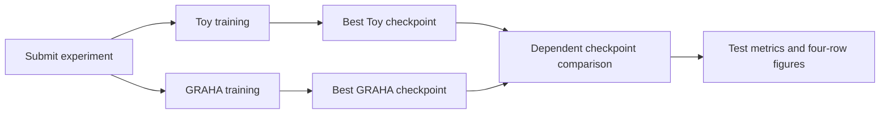

# Toy versus GRAHA 70-band instance segmentation experiment

Status: design approved and sequential implementation tickets published. Ticket 01
implements matched input configuration and persisted split membership. Ticket 02
implements shared NoData preprocessing, target clipping, runtime eligibility, and
mask-loss handling. Ticket 03 implements shared full-validation mask AP. Ticket 04
implements best/latest checkpoints, explicit full-state resume, and model result
manifests. Ticket 05 implements fresh best-checkpoint test inference, full-test
reporting, and the four-row comparison. The local synthetic figure slice is also
implemented. Ticket 06 implements the three-job Grace container submitter and
local fake-scheduler checks; full pretrained-model HPC training has not run.

## Confirmed objective and execution target

Compare Toy and GRAHA instance segmentation fine-tuning on the same existing
70-band WAC+static dataset. The initial experiment uses all 70 bands for both
models and Mask R-CNN heads. Produce a reproducible experiment runner that
executes inside a container on the HPC Slurm `grace` partition.

The user accepted the dataset and Mask R-CNN comparison and deferred changing the
number of bands: "we can just use the 70-band dataset for now I can change number
of bands later." Fixed-layout band masking was not accepted. An increasing-band
sweep remains a future extension rather than a prerequisite for this first run.

The experiment design and sequential ticket breakdown are approved. The user
also authorized a local synthetic figure slice during the interview; that slice
is implemented below. Full training/job submission follows the implementation
tickets, beginning with the matched-input slice.

## Terminology

See the project [glossary](../GLOSSARY.md). A stored input band and a GRAHA modality
are different: VIS comprises five bands, UV two, and static 63. A band selection
does not automatically resize a native pretrained modality embedding.

For a future band ablation, distinguish:

- **Selected input channels:** only selected bands enter the model tensor; its
  channel count changes between configurations.
- **Available bands:** the model retains a fixed input layout, while omitted bands
  are replaced with a defined neutral value. This measures available information
  and does not demonstrate memory or speed savings from fewer input channels.

These are candidate future experiment definitions, not interchangeable
implementations. Neither is required for the accepted all-70-band baseline.

## First decision round

| ID | Decision | Recorded decision | Status |
| --- | --- | --- | --- |
| Q1 | Dataset and split source | One existing WAC+static dataset with 70-band chips and instance labels; identical train/validation/test membership for every run | Accepted |
| Q2 | Meaning of the Toy/GRAHA comparison | DINO versus GRAHA model systems with Mask R-CNN heads, a common geometry/evaluation contract, and documented model-specific normalization, pyramids, and optimization | Accepted; normalization clarified in Q5 |
| Q3 | Meaning of increasing band count | Use all 70 bands in the initial experiment; revisit narrower or masked inputs later | Initial scope settled; ablation deferred |

The notebook currently points at
`/explore/nobackup/projects/lfm/model_inputs/300_300_inputs/fm_all_static_all_wac_iseg_v3`.
Use this existing notebook source as the initial default, with an explicit
dataset-path override and a preflight check. The dataset choice is accepted;
existence, accessibility, and contents of this particular path remain unverified
from the current workspace.

## Accepted initial model/input contract

- Both models consume all stored indices `0..69`, in chip order: five VIS bands,
  two UV bands, and 63 static bands.
- GRAHA explicitly uses native backend modalities `vis`, `uv`, and `static`;
  do not let the `wac_static` legacy default select a synthetic `wac` embedding.
- Use Toy's `dino-mask-rcnn` architecture and GRAHA's Mask R-CNN architecture.
- Use identical split membership and target geometry. Feature pyramids and
  optimization can differ by model, with resolved settings recorded per run.
- Include the band identities and selected indices in run metadata. Future
  partial selections still require an explicit supported input strategy; this
  baseline does not establish that changing a band-filter flag alone is sufficient.

## Second decision round

The user's answers supersede the original normalization and batch-size proposals.

| ID | Decision | Recorded decision | Status |
| --- | --- | --- | --- |
| Q4 | Initial training protocol | One paired seed (`42`), 50 epochs per model, full splits, 256-pixel center crops, batch size **32** for both, and unfrozen backbones; expose epochs, seeds, and batch sizes in configuration | Accepted with batch size changed to 32 |
| Q5 | Normalization and missing data | Keep Toy's own normalization and GRAHA's own statistics; repair Toy NoData handling independently | Accepted; Toy method settled in Q8 |
| Q6 | Primary result and checkpoint selection | Shared COCO-style mask AP at IoU 0.50:0.95; full validation checkpoint selection, then full test evaluation; generate the requested four-row test-chip figure | Accepted; local synthetic figure slice authorized now |
| Q7 | Slurm job layout | One independently recoverable, single-GPU Grace container job per model, sharing an experiment identifier and configuration; one submission entry point | Accepted |

The requested per-model batch size is 32 on the user's H100 allocation. Record
the assigned device name, memory, and GPU count as lightweight metadata when
available; do not benchmark capacity or add a memory-validation stage. Report an
actual out-of-memory failure rather than silently reducing the batch size. Batch
size is configurable for a deliberate retry. A single seed is an initial
comparison, not an estimate of variation across random seeds.

NoData/object treatment, checkpoint retention, and explicit recovery are settled
below. Account/QoS and resource requests are execution settings; ordinary Slurm
submission, imports, and data/model loading report any incompatibilities. Do not
add a separate environment-certification workflow.

Keep the initial crop at 256 pixels: GRAHA's current neck hardcodes a token-grid
height of 32 with patch size 8. Supporting other crop sizes requires validating
or changing that geometry, not just accepting a CLI value.

## Model-specific normalization and common NoData handling

Do not give Toy the GRAHA pretraining statistics. Model inputs may have different
normalized values while still describing the same chip and target geometry.
The experiment configuration must resolve and record normalization independently
for each model; the current shared normalization-source setting is insufficient
to express the accepted policy in full.

Toy's current notebook uses `normalization_source="finetune"` with
`toy_normalize_inputs=False`. The user explicitly chose to preserve this behavior:
per-chip, per-band min/max scaling without z-score normalization. Do not substitute
GRAHA statistics, fixed DINO RGB mean/std values, or train-split z-score statistics.
For the experiment runner this means resolving the Toy and GRAHA normalization
paths independently, even though existing workflow configuration currently has a
shared normalization-source field. GRAHA retains its own pretraining statistics.

The NoData repair must calculate each Toy band's min/max from that chip's finite,
valid pixels only. An entirely invalid band becomes neutral zeros; handle constant
valid bands explicitly and preserve their existing scaling behavior. Invalid
pixels become zero in the normalized input and remain marked invalid in targets.
Both model paths
must retain a common validity mask through cropping, target creation, loss, cache
export, and evaluation. Invalid pixels must not be counted as extra instances or
silently treated as supervised background in Toy's mask loss. Use the accepted
object and evaluation rules below at invalid boundaries.

## Final interview decisions

| ID | Decision | Recorded decision | Status |
| --- | --- | --- | --- |
| Q8 | Exact Toy normalization | Preserve current per-chip, per-band min/max scaling, without z-score normalization | Accepted through the normalization follow-up |
| Q9 | Partially invalid chips | Retain the chip and any crater with valid labeled pixels; exclude invalid pixels from mask loss/evaluation; remove targets with no valid pixels and skip chips with no valid pixels under a shared documented rule | Accepted |
| Q10 | Checkpoint retention and recovery | Save the best validation-AP checkpoint plus a full-state latest checkpoint; support explicit resume after an interruption, without silently restarting or changing batch size | Accepted |
| Q11 | Dependent test comparison job | After both training jobs succeed, run a third Grace/container job that loads both selected checkpoints and generates the four-row comparison on the same test chips | Explicitly requested and accepted |
| Q12 | Startup checks | Keep preflight minimal; avoid separate probe jobs, benchmarks, or mandatory smoke-training stages | Explicitly requested and accepted |
| Q13 | Epoch control for smoke tests | Expose `--max-epochs` on the submitter and training entry point; default to 50, allow 1 for an explicitly requested smoke run, and forward the value to both models | Explicitly requested and accepted |

Training/mask metrics must use the same treatment of validity for both models.
Derive validity from the selected 70-band raw chip and declared NoData sentinels,
not the model-normalized tensor. A pixel is outside the common labeled footprint
when any selected band is invalid. Preserve per-band image validity separately for
normalization. Build the shared split manifest from ordinary file pairing, without
an upfront pixel scan of all chips. Determine eligibility during normal sample
loading and record skipped chip identifiers and reasons. Apply the same rule in
both jobs; fail if normal loading yields no eligible samples in a required split.
The comparison checks that both results refer to the same split membership and
validity policy.

Clip ground-truth instance masks to the valid footprint, drop instances with no
remaining valid pixels, and recompute target boxes from retained masks. For mask
AP, apply the same footprint to predictions, dropping detections whose masks have
no valid pixels. Retain independent overlapping prediction masks and their scores;
do not calculate AP from flattened visualization rasters.

The existing GRAHA NoData patch addresses instance mask loss, not a general
pixelwise ignore mechanism for the RPN and box classification/regression losses.
Document that distinction and test any target/box changes caused by clipping at
the valid boundary. Figure gray regions indicate unavailable pixels, not a new
instance class.

Container, dataset, pretrained weights, caches, output paths, account, and QoS
must be configurable and recorded. Follow the minimal startup policy below and
let normal execution surface resource or compatibility errors. The dependent
comparison job must reload the two selected checkpoints
and run test inference itself; consuming training-time figure caches alone does
not satisfy the accepted checkpoint comparison requirement.

## Minimal startup policy

Keep startup work inside the three requested jobs. Only check the essentials:

- Required container/input/configuration paths are readable; the comparison job
  also requires the two result manifests and selected checkpoints.
- The output/log directories can be created and written as part of normal startup.
- CUDA is visible to the GPU process inside the container.

Ordinary configuration parsing, file pairing, model/checkpoint loading, training,
and comparison retain their necessary correctness checks. For example, reject a
checkpoint with incompatible model state or two prediction sets for different
chips when those artifacts are loaded. These are part of the requested work,
not additional preflight stages or duplicate dataset passes.

No separate preflight job, CUDA convolution/NMS probe, architecture/version gate,
capacity benchmark, full dataset scan, checkpoint/container hashing pass, or
mandatory short training run is required. The synthetic figure preview is a
standalone local convenience and is not a prerequisite for submitting training.

Record the resolved configuration, supplied container identity/path, repository
revision, Slurm job IDs, selected checkpoints, and lightweight device metadata.
Use readily available information rather than extra dependency imports or a full
environment audit. Optional diagnostics can be run explicitly when troubleshooting
an actual failure.

Use one canonical display image, preferably the raw common cropped chip, for all
four figure rows. Do not share model-normalized input tensors merely to make the
figures match.

## Three-job Slurm workflow

One submission command creates a run directory, writes the resolved experiment
configuration and shared split/chip manifest, creates log directories, and submits
two training jobs followed by the comparison job. Run every GPU stage inside the
chosen container on `grace`, with one GPU per job.

### Epoch control and optional smoke runs

The submission interface and direct training entry point must expose
`--max-epochs N`, where `N` is a positive integer. The experiment default is 50;
the command-line value overrides it and is forwarded unchanged to both training
jobs and their Lightning trainers. Record the resolved value in the experiment
configuration and both model result manifests. The existing instance training
CLI already supports this option; the new container submitter must preserve it
rather than hardcoding the full experiment budget or changing the shared CLI's
defaults for unrelated workflows.

Submission interface (run on the cluster login node):

```bash
# Optional one-epoch end-to-end smoke test.
bash scripts/shell/instance_seg/submit_instance_grace_experiment.sh --max-epochs 1

# Full experiment (also the default epoch budget).
bash scripts/shell/instance_seg/submit_instance_grace_experiment.sh --max-epochs 50
```

Both commands use the same three-job workflow. With one epoch, validate and save
the best checkpoint after that first epoch, then let the dependent job load both
checkpoints and produce the test metrics and four-row comparison. No callback may
require a later epoch before producing those artifacts. The epoch override alone
does not change batch size, selected bands, split sizes, or the test comparison.
Smoke testing remains an explicit user choice, never an automatic preflight gate.

For explicit resume, `--max-epochs` is the total target epoch count, including
epochs already completed, not a number of additional epochs. A fresh smoke run
gets a fresh run directory instead of implicitly loading a prior full experiment.



The third job is submitted with the two successful training job IDs as an
explicit Slurm dependency:

```bash
sbatch --dependency=afterok:${TOY_JOB_ID}:${GRAHA_JOB_ID} <comparison-job-script> ...
```

The submitter uses this dependency contract. It captures IDs with
`sbatch --parsable`, normalizes any returned
cluster suffix before constructing the dependency, and persists all three IDs and
their dependency in the submission manifest. Do not use completion regardless of
exit status: if either training job fails, the comparison must not run against
missing or incomplete checkpoints. Record partial submission failures so already
submitted jobs remain discoverable and a comparison can be explicitly resubmitted
after recovery. Resuming training with a new job ID requires rebuilding the
comparison dependency against the replacement job IDs.

### Implemented Grace submitter

The shell entry point uses `${PYTHON_BIN:-python3}` with only the standard library
on the host. Apptainer first runs the existing configuration/split preparation
entry point on the login node, inside the selected container, without GPU flags.
This pairs filenames and writes the manifests without reading raster pixels or
loading pretrained models. It is ordinary preparation, not a scheduler job or
training gate. All three subsequent GPU allocations use `--cleanenv --nv`, with
explicit Slurm CUDA visibility. Host Apptainer/Singularity environment injection
and implicit home/current-directory mounts are disabled. Code, datasets, weights,
and prepared manifests are bound read-only at their resolved absolute paths;
run outputs and model/plot/temporary caches are writable. No host Conda activation
is required.

For example, with paths and allocation settings appropriate to the cluster:

```bash
bash scripts/shell/instance_seg/submit_instance_grace_experiment.sh \
  --container /path/to/lfm.sif \
  --data-root /path/to/70-band-dataset \
  --dino-checkpoint /path/to/dino.pth \
  --graha-pretrain-dir /path/to/graha-pretrain \
  --run-root /path/to/new-experiment \
  --cache-dir /path/to/writable-cache \
  --log-dir /path/to/slurm-logs \
  --account my-account --qos my-qos \
  --max-epochs 1
```

Omit `--run-root` to create a unique timestamped run under `--output-root`
(default `scripts/outputs/instance_grace`). An explicit run root must be new.
Container, data and pretrained-weight defaults use the paths documented above;
these are configurable defaults, not verified cluster artifacts. `--apptainer`
selects the runtime executable, and `--container-identity` records a supplied
tag/build identifier without hashing the container. Use `--help` for all options.

Training defaults are one GPU, 128G memory, 10 CPUs, and 24 hours on `grace`.
Override them with `--train-memory`, `--train-cpus`, and `--train-time`.
Comparison has separate `--comparison-memory`, `--comparison-cpus`, and
`--comparison-time` options, initially with the same resource values, and an
independent `--inference-batch-size` defaulting to 32. Each allocation always
requests one task and one GPU. `--n-samples` controls figure columns, not test
membership. Existing preparation options expose per-model training batch sizes,
worker counts, the seed, filename pairing, and optimization settings.

`--config /path/to/defaults.json` accepts preparation option names as JSON keys,
except `run_root`. For example, `{"max_epochs": 50, "seed": 42,
"toy_batch_size": 32, "graha_batch_size": 32}`. CLI values override file defaults.
The final authoritative model settings are always written to `experiment.json`;
the source configuration path is recorded separately in `submission.json`.

The run layout includes:

- `experiment.json` and `split_manifest.json`, prepared before the first submission.
- `submission.json`, atomically updated before and after every scheduler call;
  it includes repository revision/dirty state, supplied container identity,
  resolved execution settings, commands, raw scheduler responses, normalized job
  IDs, and the two-parent `afterok` dependency.
- `logs/{toy,graha,comparison}_%j.{out,err}`, with directories created before
  submission (or the explicit external log directory).
- `pipeline.log`, the central, timestamped log for preparation, submission, both
  training jobs, test evaluation, and the final comparison plot. Each line names
  its stage and, inside an allocation, its Slurm job ID. This always lives in the
  run root, including when `--log-dir` selects external per-job Slurm logs.
- `runtime/{toy,graha,comparison}.json`, written by the actual GPU processes with
  stage arguments, scheduler identity, CUDA visibility, assigned GPU name/memory/
  count, and completion or failure. CUDA visibility is the only GPU startup check.
- `toy/` and `graha/` for the existing best/latest checkpoints and result manifests;
  `comparison/` is created by the dependent comparison, and `cache/` holds caches
  by default.

Follow one run from submission through the plot with:

```bash
bash scripts/shell/instance_seg/submit_instance_grace_experiment.sh \
  --run-root /path/to/new-two-epoch-run --max-epochs 2
tail -F /path/to/new-two-epoch-run/pipeline.log
```

The submitter prints the exact tail command before container preparation starts.
Training jobs run independently, so their timestamped lines can interleave.
Output is streamed and flushed as it arrives, with file locking across writers;
it is also echoed to the individual Slurm logs. Container stderr is combined
with stdout in the central log and echoed to the job's `.out` file; `.err`
continues to receive scheduler/host-wrapper errors. Preparation output and
scheduler submission failures are included as well.

Training uses readable lines in place of terminal progress bars: epoch starts,
the first batch, every 50 batches or after 60 seconds between completed batches,
sampled training loss, validation progress and mask AP, and saved best/latest
checkpoint paths. Test inference reports batches and eligible chip counts for
each model, skipped totals, final AP and metrics paths, followed by figure
rendering and the final figure/manifest paths. Eligibility counts use the original
split membership as the denominator; wholly invalid chips may be skipped.

The final `Pipeline complete` line is emitted only after the comparison process
succeeds. `All three jobs submitted` means the scheduler accepted the jobs.
Queued jobs emit no batch updates. Slurm cancellations, node loss, time limits,
or a kill of the entire allocation can prevent a final failure line; inspect the
per-job Slurm files and scheduler state if the central log stops unexpectedly.
This logging adds no scheduler job or polling service. Runs submitted before this
logging change do not gain the earlier submission/preparation history.

If submission fails, the command exits with the ordinary error and retains
`submission.json`, including all IDs already returned and the failed call's
stdout/stderr. Existing jobs continue; no automatic cancellation or replacement
occurs. Inspect this file before retrying. Do not rerun the submitter against the
same root: an explicit training recovery uses the existing training entry point's
`--resume /path/to/latest.ckpt` inside the same container and with the original
total epoch budget. Rebuild a comparison submission's `afterok` dependency using
both successful training IDs, including any replacements. A comparison rerun
requires a fresh comparison output directory. The recorded commands and container
launch settings provide the concrete inputs for this explicit recovery.

Local tests use scheduler and Apptainer doubles to check submission order, log
setup, dependencies, normalized IDs, resource/epoch forwarding, and retained
partial failures. Small GPU API doubles verify metadata, direct error propagation,
and entry-point forwarding. Logging checks exercise live output before process
exit, independent concurrent writers, merged stderr, and failure exit codes.
The logging update passes 70 focused logging/submission/checkpoint/comparison
checks, including real small-model training and figure rendering on the CPU.
These are never cluster startup checks; real HPC execution remains unverified.

### Training job contract

- Train its assigned model with the shared dataset manifest, all 70 bands, batch
  size 32, the accepted model-specific normalization, and the common validity rule.
- Use the resolved `--max-epochs` budget, including one-epoch runs; do not replace
  the requested value with a hardcoded trainer or scheduler epoch count.
- Measure the common mask AP on the full validation split. Do not use test AP to
  choose checkpoints.
- Save a best-validation-AP checkpoint and a latest full-state checkpoint for
  explicit recovery. The latest state must retain optimizer/scheduler state,
  progress, and sufficient recorded initialization/sampler information to resume
  consistently; a weights-only warm start is a distinct operation.
- Publish a model result manifest containing the experiment/config identity,
  model family and architecture, normalization policy, split-manifest identity,
  best-checkpoint path and validation score/epoch, and latest-checkpoint path.
- Exit successfully only after the expected checkpoint and manifest are present.

Keep the training epoch budget, batch size, seed, optimizer settings, and host
resource requests configurable and recorded. Use the current training launcher's
128 GB host RAM, 10 CPUs, and 24-hour request as initial scheduler defaults rather
than measured requirements. The dependent job has independent configurable host
memory, CPU, walltime, and inference-batch settings. Its inference batch defaults
to 32; report any failure rather than silently changing the accepted settings.

### Dependent comparison job contract

1. Read the two completed training manifests from the same experiment. Verify
   their configuration and split identities; fail on missing, stale, mismatched,
   or ambiguous artifacts.
2. Resolve each manifest's **best validation-AP checkpoint**, rather than the
   latest epoch, checkpoint filename order, or the best test score. Load its
   configuration and state strictly so each model gets its original architecture,
   70-band inputs, normalization, and NoData treatment.
3. Load Toy and run test inference, then release its GPU state before loading
   GRAHA and running test inference. Both checkpoints are reloaded within the
   dependency job; they need not occupy GPU memory simultaneously. Use evaluation
   mode and disable gradients.
4. Evaluate both checkpoints on the full eligible test split with the shared mask
   AP evaluator. Use matching detection limits and postprocessing, and keep the
   visualization confidence threshold separate from AP's score-ranked detections.
5. Produce prediction caches for the same fixed chip identifiers and the common
   raw cropped display images. Select those identifiers deterministically before
   inspecting predictions; default to five chips, configurable. Retain separate
   per-instance masks/scores for metrics and flattened ID rasters for figures.
6. Validate chip identity, spatial alignment, ground-truth partitions, and validity
   masks across both exports. Render exactly four rows: input, Toy prediction,
   GRAHA prediction, ground truth. Use the implemented shared renderer and include
   the test split and the selected checkpoint identities in the report.
7. Write aggregate test metrics, the figure(s), and a comparison manifest with
   checkpoint paths/epochs, chip IDs, display bands, confidence settings, validity
   policy, and provenance. The run is complete only when this job succeeds and
   those artifacts are present.

The third job should be independently rerunnable with explicit model-result
manifest paths, without retraining either model. It must perform fresh checkpoint
inference rather than depend on the current model-agnostic normalization defaults
or final-epoch metric discovery.

The repository has an existing dependency pattern in
[`submit_instance_three_model_finetune.sh`](../scripts/shell/instance_seg/submit_instance_three_model_finetune.sh),
while the dedicated Grace submitter implements the required two-model comparison
dependency. The older
[`instance_checkpoint_comparison_plot.py`](../scripts/python/instance_seg/instance_checkpoint_comparison_plot.py)
can reconstruct models from explicit checkpoint paths, but it is not a drop-in
implementation of this design: directory discovery chooses the last discovered
checkpoint, its default split is validation, its default Toy architecture is
Mask2Former, it shares normalization settings between models, and its model
argument reconstruction drops explicit backend modalities and the image NoData
policy. The plotting parser/configuration also disagree about the presence of
`image_nodata_policy`. Its Slurm wrapper uses host Conda on `compute`. Reuse the
useful model reconstruction and renderer after repairing these boundaries, or
provide a dedicated comparison entry point taking the authoritative result
manifests. Do not silently fall back to the old defaults.

### Output layout

```text
<run-root>/
  experiment.json
  split_manifest.json
  submission.json
  pipeline.log
  runtime/{toy,graha,comparison}.json
  logs/
  cache/
  toy/
    result.json
    checkpoints/<best-validation-checkpoint>.ckpt
    checkpoints/last.ckpt
  graha/
    result.json
    checkpoints/<best-validation-checkpoint>.ckpt
    checkpoints/last.ckpt
  comparison/
    comparison.json
    metrics.json
    {toy,graha}/predictions.json
    {toy,graha}/visualization/
    test_comparison.png
```

Exact checkpoint filenames can follow the existing naming scheme; authoritative
paths come from the result manifests. Keep the run root explicit and avoid
timestamp-based artifact discovery inside the dependency job.

## Implementation sequence and completion checks

1. **Shared experiment contract:** expand one configuration into two model-specific
   configurations; build the common eligible split manifest; keep Toy min/max and
   GRAHA pretraining normalization independent.
2. **NoData and evaluation:** carry validity through both data paths and mask
   losses, establish clipping/drop behavior, and add the shared instance AP
   evaluator without confidence-truncated or flattened-mask inputs.
3. **Checkpoint lifecycle:** select the best checkpoint by the same validation
   metric, save resumable latest state, and write authoritative per-model result
   manifests.
4. **Container/Slurm orchestration:** implement the two training launchers, the
   checkpoint comparison launcher, and one submitter wiring their `afterok`
   dependency. Reuse existing container launch conventions rather than host Conda.
5. **Development verification:** retain the implemented fake-data preview; exercise the
   new submission path with a fake `sbatch` that records two training submissions
   and a third dependency submission without contacting Slurm. Verify the
   comparison loads explicitly selected best checkpoints, respects independent
   normalization, and renders common chip geometry. Also verify that
   `--max-epochs 1` reaches both training jobs and that one epoch produces the
   checkpoints required by the dependent comparison. These are development tests,
   not per-job startup work. A short real run is optional and is not a gate before
   the requested 50-epoch experiment.

Tests must cover failed/missing parent artifacts, accidentally mixed experiment
manifests, resume with replacement job IDs, zero-instance/NoData targets, and the
four-row same-chip output. The full cluster workflow has not run locally; the
normal training and comparison jobs provide that execution evidence without an
additional validation stage.

## Implemented matched-input slice (ticket 01)

The paired input entry point prepares one experiment without training, model
loading, scheduler submission, or raster eligibility scans:

```bash
python scripts/python/instance_seg/prepare_instance_experiment.py \
  --run-root scripts/outputs/paired_70_band_smoke \
  --max-epochs 1
```

Use `--data-root`, `--dino-checkpoint`, and `--graha-pretrain-dir` to override the
documented HPC defaults. The experiment default remains 50 epochs; this command
only records the requested budget for later training. It writes `experiment.json`
and `split_manifest.json` and refuses to overwrite an existing experiment. The
Grace submitter calls this entry point inside the selected container; this is not a
separate preflight job or a required diagnostic stage.

The experiment JSON contains two independently resolved existing training
configurations, all 70 positional band identities, weight/configuration paths,
normalization policies, optimizer settings, feature-pyramid choices, and a
configuration identity. Toy uses `dino-mask-rcnn`, per-chip/per-band min/max, and
no z-score normalization. GRAHA explicitly uses native `vis`, `uv`, and `static`
with its pretraining statistics. The legacy shared CLI's 100-epoch default is
unchanged. Model batch sizes, worker counts, seed, and optimizer options are
configurable; unsupported band/crop/model overrides are rejected for this baseline.

The split manifest records complete train/validation/test file pairing and stable
split-qualified chip identifiers, with relative image/label paths and a membership
identity. Its creation reads filenames rather than pixel arrays, and checks for
missing labels and repeated image paths across splits. These small JSON identities
do not hash datasets, checkpoints, or container artifacts. Stored band identities
are modality-relative positions; names for the 63 static measurements are not
invented or asserted without dataset metadata.

The developer-facing data path is:

```python
from lfm.all_models.inst_seg.paired_experiment import (
    create_experiment_datamodule,
    load_experiment,
)

experiment, membership = load_experiment("scripts/outputs/paired_70_band_smoke")
toy = create_experiment_datamodule(
    experiment, membership, "toy", include_raw_image=True,
)
graha = create_experiment_datamodule(
    experiment, membership, "graha", include_raw_image=True,
)
```

These are the actual Toy DINO Mask R-CNN and GRAHA object-detection datamodules,
with persisted membership supplied to their datasets. Newly appearing files do
not change membership or Toy's metadata source. Setup performs ordinary sample
loading and reads GRAHA's normalization YAML; it does not load model weights.
`include_raw_image=True` exposes the common unnormalized 256-pixel center crop
and chip identifier through both datasets and detection collators. It defaults
to false to avoid carrying a second image tensor during normal training. Toy's
existing scaling order is retained: calculate min/max on the stored chip before
the center crop. Existing package-level exports are lazy, allowing data loading
without importing the optional datacube-inference dependency `tiler`.

Fixture verification uses real 70-band GeoTIFFs, instance NPZ labels, and a
VIS/UV/static statistics YAML. It checks matching membership, chip IDs, raw crops,
masks, and boxes through both real adapters, while comparing each normalized
tensor against its own expected transformation. It also exercises the existing
GRAHA task argument builder to verify native modalities without new embeddings,
and prepares manifests from intentionally unreadable raster bytes to demonstrate
that preparation does not inspect pixel data. Run the focused checks with:

```bash
MPLBACKEND=Agg python -m pytest -q scripts/python/tests/test_paired_instance_experiment.py
```

This slice provides configuration and data adapters for the subsequent training
tickets. Existing training workflows have not yet been wired to this manifest
factory. Tickets 02 and 03 add the NoData behavior and shared validation AP below;
checkpoint lifecycle and Slurm orchestration remain in tickets 04–07. The configured HPC
paths remain unverified locally.

## Implemented NoData training slice (ticket 02)

Both real model-specific adapters now retain `image_valid_mask` (per-band validity)
and `valid_mask` (the common labeled footprint) through cropping and detection
collation. Validity is derived from raw finite values, the raster's declared
NoData value, and explicitly configured excluded sentinels, before normalization.
Band filtering precedes the common-footprint calculation. A target pixel must be
valid in every selected band and must not carry the configured ignore label.

Toy computes min/max from the original valid pixels in each band before any
missing-pixel filling. Constant valid bands keep their original values; missing
bands and invalid output pixels become zeros. GRAHA keeps its own pretraining
mean/std and receives zeros at invalid pixels after normalization. Each image
band retains independently usable data even where another band makes the common
target footprint invalid.

Instances are clipped to the valid footprint. Wholly invalid objects disappear,
remaining objects retain their identifiers, and boxes/counts are rebuilt from the
cropped valid masks rather than trusted from stale label metadata. Valid chips
without instances remain supported, including batches consisting entirely of
empty-instance chips. Both TorchVision training paths encode ignored mask pixels
and use the shared validity-weighted ROI mask loss. Toy's validation-loss forward
uses the same exclusion and restores the model's prior mode afterward. This
excludes invalid pixels from instance mask loss; it does not create a pixelwise
ignore mechanism for RPN or box classification/regression losses.

The paired datamodule factory enables runtime skipping. Wholly invalid **cropped**
footprints return a skip record during ordinary loading. The shared eligible
loader collects eligible samples until it fills the requested batch size; only
the final batch can be smaller. It never substitutes another chip for a skipped
identifier or duplicates an eligible sample. A full traversal with no eligible
samples raises a clear error for train, validation, or test. Existing Toy Mask
R-CNN and GRAHA training datamodule builders also enable this loader when NoData
exclusion is requested. No pixel pre-scan or additional startup stage is added.

Each model's `eligibility/` directory receives split-qualified chip IDs, skipped
image/label paths, and reasons. `<split>_skips.jsonl` appends observed skip events
(including repeated visits); `<split>.json` records a completed traversal and
its eligible IDs/skips. Shortened preview traversals write `<split>_partial.json`
instead of replacing a complete report. Records from loader workers are collected
and written in the parent process.

The eligible loader deliberately does not advertise a length, because its actual
batch count is unknown before loading. This lets Lightning detect exhaustion and
run validation at the end of the first epoch even when chips were skipped.
`batch_count_upper_bound` exposes the nominal batch count from membership without
reading pixels. For GRAHA's step scheduler, the downstream wrapper uses that
nominal count, epoch budget, and gradient accumulation to resolve the cosine
budget when Lightning cannot estimate an exact step count. It records the value
in checkpoint hyperparameters and logs it; explicit cosine budgets are retained.
Toy's epoch-based scheduler is unchanged. Actual step counts can be lower when
chips are skipped; a pixel eligibility scan is not introduced to refine them.

Detection cache export/import now preserves common and per-band validity, chip
identity, and negative ground-truth ignore pixels. Visualization predictions are
cleared outside the footprint. These remain visualization caches; independent
overlapping masks/scores feed the independent shared COCO evaluator described below.

Development checks in `test_instance_nodata_training.py` use real GeoTIFF/NPZ/YAML
fixtures and real small TorchVision Mask R-CNN detectors. They cover both production
downstream wrappers, finite forward/backward passes with partial NoData and
empty-only targets, zero gradient in invalid ROI bins, stale-box replacement,
entirely invalid bands/crops, runtime skip reports, worker-to-parent reporting,
cache validity round trips, and an actual one-epoch Toy Lightning fit/validation.
The GRAHA wrapper is driven by a small detector-backed test base; these checks do
not initialize pretrained GRAHA/TerraTorch or DINO backbones.

Use the `lfm-codex` micromamba environment for development verification. The user
authorized adding the required CPU testing dependencies there. Its Python can
be invoked directly if `micromamba run` cannot write its process lock:

```bash
MPLBACKEND=Agg /home/ajkerr1/micromamba/envs/lfm-codex/bin/python -m pytest -q \
  scripts/python/tests/test_instance_nodata_training.py \
  scripts/python/tests/test_paired_instance_experiment.py \
  scripts/python/tests/test_mask_rcnn_nodata.py \
  scripts/python/tests/test_instance_comparison_plot.py
```

The worker check needs ordinary multiprocessing/shared-memory permissions. These
tests are development verification, not mandatory per-job smoke training or HPC
environment certification.

Validation: all 40 focused and related tests passed in `lfm-codex`, including the
worker check with ordinary process/shared-memory permissions. No pretrained-model
or HPC training was performed.

## Shared validation mask AP (ticket 03)

Both downstream Mask R-CNN routes use
`lfm/all_models/inst_seg/mask_ap.py`. Toy retains its validation-loss diagnostic
and adds inference; GRAHA replaces the inherited validation metric hooks and
bypasses TerraTorch's additional score filtering and NMS. Each eligible validation
batch updates the same evaluator. It computes once after the full split, logs
`val_mask_ap`, and discards its state before the next epoch. This is the COCO
precision-recall aggregation across the split, not an average of per-chip or
per-batch AP. `val_mask_ap_chips` records the evaluated eligible chip count.
Both checkpoint callbacks monitor `val_mask_ap` in maximize mode. Best/latest
retention and result manifests remain ticket 04.

The common protocol is explicit in `MASK_AP_PROTOCOL`:

- One foreground class, crater (label 1), all object areas, IoUs 0.50 through
  0.95 inclusive in steps of 0.05, and 101 recall points from 0 to 1.
- Independent mask probabilities become binary at `> 0.5`. Intersect prediction
  and target masks with the same raw-derived, cropped `valid_mask`; drop masks
  with no remaining pixels. Preserve independent overlapping masks and scores.
- During metric inference, set the detector's box score threshold to 0, box NMS
  threshold to 0.5, and detection limit to 1,000 per chip. RPN evaluation uses
  1,000 proposals both before and after NMS, with RPN NMS at 0.7. Detector box
  NMS remains part of the common postprocessing; there is no extra task-level
  NMS or visualization confidence filter. Restore prior detector settings after
  inference, including when inference raises.
- COCO maximum-detection settings are `[1, 10, 1000]`; aggregate AP uses 1,000.
  This is COCO-style **AP@1000**, chosen for dense crater chips, rather than the
  standard COCO AP@100 limit. External detection inputs are also stably sorted
  by descending score and limited to 1,000 after validity clipping. The detector
  itself limits outputs before clipping; it does not refill clipped detections.
- Retain valid chips with no targets and/or no predictions. Detections on empty
  chips contribute false positives to the split's precision-recall curve. With
  targets but no detections, AP is 0. If the entire eligible split has no targets,
  AP is undefined and retains COCO's `-1` sentinel. A split with no eligible chips
  fails during loading; computing an evaluator with no chips also fails.

The evaluator stores CPU run-length encoded masks and uses `pycocotools`, already
declared in `requirements_container.txt`, for matching and accumulation. It reads
the all-area precision tensor at the selected detection limit directly because
[COCO's summary implementation](https://github.com/cocodataset/cocoapi/blob/master/PythonAPI/pycocotools/cocoeval.py)
hardcodes a 100-detection limit for aggregate AP. No dense prediction tensors are
retained on the GPU across batches. Plotting caches, flattened instance-ID maps,
and confidence-truncated figure predictions never enter this evaluator.

The paired configuration defaults to full split membership and rejects
`run_epoch_test_suite=True`. Both trainers validate every epoch, starting with
epoch one, with no sample/batch cap or sanity-validation pass. Existing runtime
eligibility reports identify eligible and skipped chips. GFFT explicitly keeps
its existing validation hooks; this ticket changes the paired Toy/GRAHA routes.
The held-out test split is reserved for the final checkpoint comparison.

Development verification adds `test_instance_mask_ap.py` to the ticket 02 command:

```bash
MPLBACKEND=Agg /home/ajkerr1/micromamba/envs/lfm-codex/bin/python -m pytest -q \
  scripts/python/tests/test_instance_mask_ap.py \
  scripts/python/tests/test_instance_nodata_training.py \
  scripts/python/tests/test_paired_instance_experiment.py \
  scripts/python/tests/test_mask_rcnn_nodata.py \
  scripts/python/tests/test_instance_comparison_plot.py
```

The AP cases cover perfect and overlapping detections, low confidence scores,
false positives, missed instances, all ten IoU thresholds, empty targets and
predictions, NoData clipping/removal, dense chips, the common detection cap,
plotting-threshold independence, and restoring detector settings on failure.
An actual one-epoch Lightning fit through each production downstream wrapper
uses the real matched data adapters and a small CPU Mask R-CNN. Both verify full
eligible validation membership, the shared metric and chip count, an epoch-one
checkpoint, and no test traversal. The GRAHA check substitutes the pretrained
TerraTorch initialization with a detector-backed base matching its output
wrapper; no pretrained backbone or HPC training is run.

Validation: 54 focused and related tests passed, including all 14 AP checks and
the worker regression with normal process/shared-memory permissions. A targeted
GRAHA one-epoch rerun also passed after aligning its inherited monitor property.
Ruff passes for the changed Python files. Local verification used the existing
`lfm-codex` environment with `pycocotools` installed in `/tmp/lfm-mask-ap-deps` and
`PYTHONPATH=/tmp/lfm-mask-ap-deps:.`; `OMP_NUM_THREADS=1` and `MKL_NUM_THREADS=1`
bounded CPU test threading. Production already declares `pycocotools` in its
container requirements. These remain development checks, not job preflight.

## Implemented checkpoint lifecycle (ticket 04)

The direct paired training entry point is
[`train_instance_experiment.py`](../scripts/python/instance_seg/train_instance_experiment.py).
It loads the prepared configuration and split membership from ticket 01 and uses
the existing Toy/GRAHA model builders with the matched adapters. For example:

```bash
# Prepare a fresh default 50-epoch experiment; supply dataset/weight overrides as needed.
python scripts/python/instance_seg/prepare_instance_experiment.py --run-root /path/to/run
python scripts/python/instance_seg/train_instance_experiment.py --run-root /path/to/run --model toy
python scripts/python/instance_seg/train_instance_experiment.py --run-root /path/to/run --model graha

# Explicit optional one-epoch run: use a fresh run root.
python scripts/python/instance_seg/prepare_instance_experiment.py --run-root /path/to/smoke --max-epochs 1
python scripts/python/instance_seg/train_instance_experiment.py --run-root /path/to/smoke --model toy --max-epochs 1
python scripts/python/instance_seg/train_instance_experiment.py --run-root /path/to/smoke --model graha --max-epochs 1

# Resume an interrupted run from its latest completed epoch.
python scripts/python/instance_seg/train_instance_experiment.py --run-root /path/to/run --model toy --resume /path/to/run/toy/checkpoints/last.ckpt --max-epochs 50
```

`--max-epochs` is a positive total target, including completed epochs. If omitted,
it uses the prepared configuration (default 50). An explicit override reaches the
task's scheduler configuration and actual Lightning trainer unchanged, and is
recorded in `result.json`. Resume requires the original total budget so that the
restored schedule retains its original meaning; changing the experiment, model,
split membership, output directory, or budget fails directly. A checkpoint that
already reached the target also fails as a resume request. To start a new fine-tune
from saved model weights, prepare a fresh run and pass `--initialize-weights PATH`;
this strictly loads weights and starts new optimizer, scheduler, and progress
state. It is mutually exclusive with `--resume`. Fresh training never searches for
or loads earlier checkpoints and refuses an output containing training artifacts.

Each model publishes the following under `<run-root>/<toy|graha>/`:

- `checkpoints/best-epoch-NNN.ckpt`: the checkpoint with highest whole-validation
  `val_mask_ap`; ties retain the earlier checkpoint.
- `checkpoints/last.ckpt`: the latest completed epoch, even when AP declined.
- `result.json`: an atomically published completion manifest identifying both
  checkpoint paths and zero-based epochs, best score, architecture, model-specific
  normalization, validity rules, initialization, resolved configuration/budget,
  sampler policy, and experiment/split identities. The prepared `config_id` remains
  the identity of `experiment.json`; `training_identity` additionally records the
  resolved epoch override and sampler policy.

Both checkpoints contain full Lightning model/optimizer/scheduler/loop state, plus
Python, NumPy, Torch, and CUDA RNG state and the paired training identity. Recovery
starts at the next epoch; it does not replay a partial epoch. Training uses an
epoch-addressable permutation seeded by `seed + zero_based_epoch`, with separate
loader generators and deterministic crop/preprocessing. RNG restoration happens
after initialization and loader setup. No pixel scan or diagnostic training stage
is added. Best checkpoint pruning waits until the latest checkpoint is durable,
so a failed latest write retains the previous recovery checkpoint's selected best.

Training validates every epoch, including epoch one. Missing, non-finite, or
undefined AP (including COCO's target-free `-1` sentinel) fails checkpoint selection.
Only a completed epoch budget with both required nonempty checkpoint files can
publish a result manifest and report success. Interrupted/failed attempts do not
publish success. These lifecycle guarantees apply to this paired entry point;
legacy standalone notebook workflows retain their existing checkpoint behavior.

Development verification adds
`scripts/python/tests/test_instance_checkpoint_lifecycle.py` to the ticket 03
verification command. It exercises a deliberately non-monotonic AP sequence,
first-epoch artifacts through both downstream wrappers, strict weights loading,
resume identity/state failures, publication failures, and exact optimizer,
scheduler, model RNG, and sample-order restoration against uninterrupted training.
These checks run separately from production startup. Full pretrained GPU/HPC
training remains unverified.

Validation: all 73 focused and related tests passed, including 19 new lifecycle
checks and the existing worker regression with normal process/shared-memory
permissions. New lifecycle files and other touched files pass Ruff;
`iseg_model.py` retains only pre-existing lint findings. No production dependency
changes or startup verification stages were added.

## Standalone held-out checkpoint comparison (ticket 05)

After both direct training runs publish complete results, run:

```bash
python scripts/python/instance_seg/compare_instance_experiment.py \
  --toy-result /path/to/run/toy/result.json \
  --graha-result /path/to/run/graha/result.json \
  --output-dir /path/to/run/comparison-01
```

The two result paths are required. Each remains in its original model output
directory beside the prepared `experiment.json` and `split_manifest.json` in
the run root. Ordinary loading checks the recorded architecture, full resolved
configuration (including an explicit training epoch override), identities,
normalization, validity, and validation selection policy. It checks both retained
checkpoint files and their full-state callback provenance against the result;
missing, incomplete, stale, ambiguous, or mixed results fail. No checkpoint
directory search, filename ordering, latest-epoch selection, or test-based
selection occurs. Checkpoints are trusted local Lightning artifacts, loaded with
the same pickle trust requirement as explicit training resume.

The comparison creates each architecture through the existing builders, strictly
loads its recorded best checkpoint, and infers in evaluation mode under
`torch.inference_mode()`. Toy finishes and releases its GPU state before GRAHA is
constructed. The data adapters independently retain Toy's valid-value per-band
min/max scaling and GRAHA's pretraining z-score statistics. The recorded dataset,
initialization/configuration assets, and GRAHA modality statistics must remain
available at their configured paths. Training is never called, and training-time
prediction caches are never used as the inference source.

Inference defaults to batch size **32**, independently of the training batch
sizes. Use `--batch-size N` for an explicit change; an OOM propagates without an
automatic retry or batch reduction. Every eligible test chip enters the shared
mask AP evaluator under exactly the full-validation detector settings. Negative
chips remain in the metric population; wholly invalid crops are skipped during
normal loading. Both traversals must cover the whole persisted test membership
with identical eligibility and skip reasons. Metrics can report the shared
COCO undefined-AP sentinel (`-1`) when the entire eligible test split has no
ground-truth instances.

Display selection is the first eligible chips in sorted chip-ID order. The Toy
loader buffers only enough ordinary batches to fix these identifiers before the
first prediction, without a separate pixel scan. `--n-samples N` overrides the
default **5**; a smaller eligible population displays all of it and records the
requested and actual counts. The same columns are used for both models. All
exports are checked for chip/source identity, crop geometry, ground-truth
partitions (allowing instance renumbering), common and per-band validity, and
identical raw RGB crops. Display stretching uses valid pixels of the raw cropped
stored bands **3, 1, 0**, independently of either model's inputs. An optional
`--display-score-threshold` (default **0.5**) affects only visualization, never AP.

Use a fresh output directory for every attempt, including reruns. Outputs are:

- `comparison.json`: atomically published success manifest, including both input
  result snapshots, checkpoint paths/epochs/scores, configuration/split identities,
  normalization and validity policies, detector/confidence settings, selected
  chip IDs/bands, and output paths. Failed runs never publish this success file.
- `metrics.json` and `{toy,graha}/metrics.json`: full-test AP and eligible counts,
  independent of the displayed subset. The common metric protocol is recorded.
- `{toy,graha}/eligibility/test.json`: complete traversal membership/skips, with
  the ordinary loader's skip event log alongside it. Training reports are left
  untouched.
- `{toy,graha}/predictions.json`: chip-ID to per-chip NPZ index. Each artifact
  retains independent thresholded prediction masks, scores, labels, original
  detector boxes, target masks/labels/boxes, validity, source paths, raw RGB, and
  plotting rasters. Masks are clipped to validity and bit-packed along width with
  NumPy's default big-endian bit order; overlaps remain independent. Unpack using
  `np.unpackbits(bits, axis=-1, count=valid_mask.shape[1])`. These arrays reproduce
  metric input; empty detections and masks outside validity are handled by the
  shared evaluator, independently of display filtering.
- `{toy,graha}/visualization/*.npz` and `test_comparison.png`: selected-chip caches
  and the existing renderer's exact four rows, deterministic colors, red boxes,
  gray NoData, test-split heading, and best-checkpoint/zero-based epoch labels.

Local checks use small real Mask R-CNNs with the production data adapters and both
downstream wrappers. They verify fresh explicit strict loads, best versus latest,
recorded epoch overrides, independent normalized inputs, complete eligibility,
mask-artifact AP replay, overlapping low-confidence masks, empty/NoData examples,
same-chip figure output, reruns, OOM propagation, and rejection of incompatible
artifacts. They do not load the full pretrained backbones or run on a GPU. These
development checks are not production startup stages. The synthetic preview below
remains independent of Torch/model imports and measured metrics.

## Test-chip comparison figure and implemented local slice

Each column represents the same test chip, in this row order:

1. Input chip (a common RGB display from stored bands 3, 1, 0).
2. Toy prediction.
3. Full model / GRAHA prediction.
4. Ground truth.

Use the existing validation callback's deterministic instance colors and red
bounding boxes. Real figures must identify the split and selected checkpoints;
full-test aggregate AP belongs in the results report, independently of the small
displayed chip subset. Choose the displayed chip identifiers deterministically
without looking at either model's predictions and use them for both models.

The synthetic vertical slice is implemented in
[`preview_instance_comparison.py`](../scripts/python/instance_seg/preview_instance_comparison.py).
It generates 70-band dummy chips, illustrative prediction errors, an empty ground
truth case, and NoData regions. It uses the same NumPy/Matplotlib renderer as the
compact real-cache comparison; it loads no model, dataset, Torch, or Lightning and
performs no training. Every synthetic figure is visibly labeled as synthetic and
its manifest contains no measured performance metrics.

With a Python environment containing NumPy and Matplotlib, run from the repository
root:

```bash
python scripts/python/instance_seg/preview_instance_comparison.py
```

An existing local environment can run it directly:

```bash
MPLCONFIGDIR=/tmp/lfm-comparison-mpl /home/ajkerr1/micromamba/envs/pace-vcf/bin/python scripts/python/instance_seg/preview_instance_comparison.py
```

Default outputs:

- `scripts/outputs/instance_comparison_preview/test_chip_comparison_dummy.png`
- `scripts/outputs/instance_comparison_preview/preview_manifest.json`

Use `--output-dir`, `--n-samples`, `--chip-size`, `--seed`, and `--dpi` to adjust
the preview; `--overlay` renders masks over the input while keeping four rows.
These preview-only settings do not change the accepted training configuration.

The shared renderer is
[`instance_comparison_plot.py`](../lfm/all_models/instance_comparison_plot.py).
The existing `plot_instance_cache_comparison` entry point now defaults to the
compact layout and retains its prior extra overlay rows through
`layout="detailed"`. It checks shared chip identity, prediction/target geometry,
instance partition agreement even with renumbered IDs, and the target NoData
footprint. Independently normalized model images are allowed. The optional
`display_images` argument supplies canonical raw CHW images; callers that omit it
continue to display the first cache's image. The final experiment must supply the
canonical images explicitly.

This figure slice does not repair the training loss, implement COCO evaluation,
or launch Slurm jobs. Flattened ID masks remain visualization artifacts, not the
input to the common AP evaluator.

Local validation: five focused tests pass, including subprocess execution without
Torch/Lightning/Transformers imports, one-chip empty predictions with NoData,
rejection of mismatched geometry, and allowance for independently normalized
inputs with equivalent instance targets. Ruff checks pass. The generated preview
was visually inspected. The actual compact cache adapter was also exercised in
isolation against synthetic NumPy caches. Importing the full existing plotting
package in the local ML environment still requires the unrelated optional
`tiler` dependency; complete model/container execution remains an HPC check.

## Design tree

1. Dataset and split source (Q1)
   - Verify stored channel identities, order, units, instance labels, and alignment.
   - All 70 bands are settled for the initial run; nested band configurations are deferred.
   - Establish split integrity, spatial independence, and a common valid footprint.
2. Comparison claim (Q2)
   - Choose Toy architecture, initialization, and backbone freeze policy.
   - Define model-specific normalization and common NoData handling (Q5).
   - Choose the primary metric, checkpoint selection rule, and held-out test protocol.
   - Set seeds, training budget, and aggregation/reporting requirements.
3. Band-count definition (Q3: all 70 initially; ablation deferred)
   - Preserve native GRAHA inputs in the initial run.
   - Specify normalization and NoData behavior for both model families (Q5).
   - Reopen omitted-band treatment only when an ablation is requested.
4. Grace container execution (three-job layout and recovery accepted)
   - Check readable paths, writable outputs, and visible CUDA; record basic metadata.
   - Expose resource requests without a separate capacity-validation stage.
   - Wire the two training jobs and the dependent checkpoint comparison.
   - Define run configuration, artifact locations, provenance, and result summaries.
5. Acceptance and implementation
   - Complete focused development tests; use minimal startup checks in real jobs.
   - Implement the approved design in the published sequential ticket order.

All experiment-design questions are settled in the decision tables. Environment
facts are resolved through normal submission/loading/execution, not additional preflight
questions. The user approved the design and ticket breakdown; further design
confirmation is not required to implement the agreed scope.

## Findings the implementation must address

These findings come from local code inspection. Full pretrained-model execution
has not been validated in the current workspace.

The list records the original audit state. The implemented ticket 01/02 sections
above describe the input and NoData findings already repaired.

1. **Partial native modalities fail (future ablation).** GRAHA expects VIS=5, UV=2, and static=63
   channels. Its modality argument builder accepts whole modalities, rejects
   partial selections, and allows synthetic `wac` inputs through a separate path.
   Synthetic inputs introduce a new embedding rather than retaining the native
   pretrained VIS/UV/static input embeddings. See
   [modality arguments](../lfm/full_model/inst_seg/instance_graha_components.py)
   and [channel definitions](../lfm/all_models/all_tasks/config_defaults.py).
2. **Normalization must remain model-specific.** Toy normalization is opt-in. Its finetuning-statistics
   path applies per-chip min/max scaling; GRAHA's corresponding path does not.
   Toy also does not forward the configured image NoData policy. Preserve each
   model's chosen statistics while fixing the missing-data contract. See
   [Toy components](../lfm/toy_model/inst_seg/instance_toy_components.py).
3. **NoData exclusion differs.** GRAHA has a validity-aware instance mask loss.
   Toy's Mask R-CNN dataset does not retain the validity mask needed to match that
   behavior. Adding bands can also change the valid footprint and resulting
   targets unless the experiment explicitly controls it. See
   [Toy detection dataset](../lfm/toy_model/inst_seg/lightning_wrappers/toy_dino_mask_rcnn_datamodule.py)
   and [shared datasets](../lfm/all_models/inst_seg/data/instance_dataset.py).
4. **Evaluation needs a common contract.** The prediction cache collapses
   overlapping instance masks into one ID raster. Epoch suites filter confidence
   before their custom AP calculation. Preserve per-instance masks and scores for
   the agreed evaluator; separate metric collection from visualization. See
   [prediction cache](../lfm/all_models/inst_seg/prediction/instance_prediction_cache.py)
   and [test suite](../lfm/all_models/inst_seg/testing/instance_test_suite.py).
5. **Checkpoint sweep configuration fails.** The sweep sets plotting frequency to
   zero, but validation requires at least one. Its reconstructed arguments also
   omit explicit backend modalities, dataset modality, and image NoData policy.
   See [sweep configuration](../lfm/all_models/inst_seg/sweep_config.py),
   [validation](../lfm/all_models/all_tasks/config_validation.py), and
   [checkpoint runner](../scripts/python/instance_seg/instance_checkpoint_sweep.py).
6. **Toy initialization has edge cases (outside the initial 70-band Mask R-CNN scope).** Three-band inputs bypass the configured
   spectral kernel mapping. The Mask2Former freeze path references `.model`
   instead of the custom backbone's `.encoder`. Exercise any chosen input/freeze
   combinations before a large run. See
   [DINO Mask R-CNN](../lfm/toy_model/inst_seg/dino_mask_rcnn_model.py) and
   [Mask2Former construction](../lfm/toy_model/inst_seg/iseg_model.py).
7. **Defaults do not define the study protocol.** Toy defaults to Mask2Former,
   checkpoints use different validation quantities across families, epoch suites
   default to the test split, and sampled evaluation may cover only part of a
   split. Each choice must be explicit in the accepted experiment design.
8. **Saved weights are not resumable training state.** Both model checkpoint
   callbacks set `save_weights_only=True`, but the fit workflows pass supplied
   checkpoints as Lightning `ckpt_path` values. True recovery needs optimizer,
   scheduler, and training progress state; distinguish that from initializing
   weights for a fresh fine-tune. See
   [Toy workflow](../lfm/all_models/inst_seg/workflows/instance_toy_workflow.py)
   and [GRAHA workflow](../lfm/all_models/inst_seg/workflows/instance_graha_workflow.py).

Prioritize model-specific normalization with consistent NoData handling, shared evaluation/checkpoint selection,
and the container runner for the initial baseline. Partial-modality adaptation,
three-band initialization, and Mask2Former freezing are outside this initial
implementation scope. Repair the standalone checkpoint sweep only if the chosen
evaluation design uses it; otherwise evaluate through the experiment runner.

Configuration checks exercised without ML dependencies confirmed that native
5-band VIS, 7-band VIS+UV, and 70-band VIS+UV+static selections pass the channel
checks; 1/3-band VIS and 12-band partial-static selections fail. A synthetic
12-band input passes the channel check. These checks do not establish that a
complete model trains successfully.

## Existing Grace/container launch patterns

The GPU launch reference is
[`scripts/shell/test_container.sbatch`](../scripts/shell/test_container.sbatch).
It requests `grace` and one GPU, uses `apptainer exec --cleanenv --nv`, explicitly
preserves Slurm's `CUDA_VISIBLE_DEVICES`, mounts the repository, and configures
headless plotting. Its small dependency-test resource request is not a training
resource estimate.

Existing instance training wrappers instead request `compute`, activate host
Miniforge/Conda, and run Python directly. Their host-specific GDAL/PROJ environment
paths must not be carried into the container launcher. See
[`sbatch_instance_seg_single_finetune.sh`](../scripts/shell/instance_seg/sbatch_instance_seg_single_finetune.sh).

The instance chip-creation wrapper supplies a useful shared-filesystem mapping:
`/panfs/ccds02/nobackup:/explore/nobackup`. Its default container artifact is
`/explore/nobackup/projects/lfm/containers/lfm-container-ipyleaflet`; this is an
existing default, not a verified choice for training. That wrapper is a CPU
preprocessing job and does not supply the GPU execution pattern. See
[`sbatch_create_instance_wac_static_chips.sh`](../scripts/shell/instance_seg/sbatch_create_instance_wac_static_chips.sh).

Repository documentation targets ARM64/aarch64 containers and mounts code, model
weights, and datasets separately. Container build checks alone do not establish
successful GPU model training. See [container documentation](container_build.md).

Launcher requirements:

- Accept explicit container, dataset, weight/cache, configuration, and output paths.
- Bind input artifacts read-only and provide separate writable output/cache paths.
- Check CUDA visibility in the actual allocation and container; record device
  metadata without running synthetic GPU probes.
- Preserve Slurm GPU visibility and avoid host Python/Conda environment leakage.
- Record repository revision and dirty state, supplied container identity/path,
  resolved configuration, split membership, selected bands, and seeds without
  hashing large artifacts or auditing the full installed environment.
- Create Slurm log directories before submission, not inside the allocated job.
- Start the requested experiment directly; short diagnostic runs are optional.

Cluster settings and paths must be configurable. Missing inputs, scheduler
rejections, import errors, or GPU failures should produce direct errors from the
normal submission/training/comparison path, without a separate cluster audit.

## Completion criteria

- Deterministic experiment expansion with unambiguous band identities and seeds.
- Matched sample membership, target geometry, and valid footprint; independently
  recorded and validated normalization for each model.
- Correct 70-band embedding initialization; future omitted-band behavior is deferred.
- A shared instance evaluator that retains overlapping detections and scores.
- Validation-only checkpoint selection followed by held-out test reporting.
- Two training submissions followed by a comparison submission with an `afterok`
  dependency on both training IDs; reload each explicitly selected best checkpoint
  and generate the four-row comparison on identical test chips.
- A user-selected `--max-epochs 1` run follows the same pipeline and produces
  first-epoch checkpoints, test metrics, and the four-row figure; the full-run
  default remains 50 epochs.
- Normal jobs train, save/load their checkpoints, and complete test evaluation;
  no separate GPU smoke job or mandatory short-run gate.
- Durable run status, recovery rules, provenance, and a consolidated comparison
  table; report variation across seeds if repeated seeds are included.

No ADR has been accepted. Record an ADR only if the interview settles a costly,
non-obvious design trade-off; routine parameter choices belong in this document.

## Reusable training and artifact ownership

The architecture refactor keeps the commands and version-1 instance artifacts
above compatible. Training lifecycle behavior now lives in
`lfm/all_models/recorded_training.py`; instance experiment descriptions and
preparation live in `lfm/all_models/inst_seg/training.py`. Both publication and
completed-result validation use the same run description. The shared lifecycle
has no instance metric, architecture, or paired-experiment dependency.

For instance training, the Python interface is:

```python
from lfm.all_models.inst_seg.training import begin_training
from lfm.all_models.recorded_training import Pretrained, Resume, WeightsOnly

attempt = begin_training(run_root, "toy", max_epochs=2, start=Pretrained())
prepared = attempt.prepare()
result = attempt.fit(prepared)
```

`WeightsOnly(path)` strictly initializes a fresh model with fresh training state;
`Resume(path)` restores a trusted full-state checkpoint using its original
output directory and total epoch budget. `prepare()` seeds RNG before building
data and models, uses the effective epoch budget, and starts the sampler at the
validated resume epoch. An attempt can be prepared and fitted once, and rejects
a model prepared for another attempt. RNG restoration still happens after
Lightning setup. Success is invalidated before fitting and published atomically
only after best/latest checkpoints and total progress are complete. The existing
instance callback state key remains compatible with earlier checkpoints.

`load_completed_pair(toy_result, graha_result)` validates both result manifests
and shared experiment identity before inference. Its handles contain metadata,
not checkpoint tensors. During each traversal, `prepare_for_test` configures the
batch size, sorted membership, raw display data, and separate eligibility report
destination before data setup. `CompletedTraining.best_weights()` validates the
latest checkpoint as progress evidence, releases it, then reads the exact best
checkpoint once for strict loading. Model resources are released before the next
architecture is constructed.

The existing Toy/GRAHA model adapters also support an explicit semantic recorded
training path:

```python
from lfm.all_models.recorded_training import RunSpec
from lfm.all_models.sem_seg.recorded_training import begin_training

# config is a SemanticSegmentationExperimentConfig with a fresh output directory
# and both legacy lightning_checkpoint fields unset.
attempt = begin_training(config, RunSpec("graha", "semantic", max_epochs=2))
result = attempt.fit(attempt.prepare())
```

This opt-in path uses the real semantic data/task adapters and records full
training state. Toy selects minimum `val_loss`; GRAHA selects minimum `val/loss`.
Finite losses above one are valid. It performs training and validation only;
loading selected best weights and running test evaluation are explicit actions.
The existing semantic workflow entry points keep their weights-only checkpoint
behavior, evaluation split, and final-model evaluation. Their old checkpoints
can initialize weights through `WeightsOnly`; they are not full-state resume
artifacts. Toy semantic data construction now accepts the NoData settings
already supplied by its shared datamodule.

`lfm/all_models/experiment_execution.py` owns the three process roles:
`submit(SubmissionRequest)` returns a receipt containing the submission manifest,
pipeline log, and job IDs; `launch(submission, stage)` runs the allocated
container and returns its exact status; `run_allocated(stage, metadata_path,
arguments)` records GPU metadata and starts training or comparison inside the
container. Requests group preparation, container, paths, resource, scheduler,
and inference settings. The preparation settings own the epoch budget. Durable
submission state and container commands remain internal, and
`lfm/artifacts.py` owns JSON replacement for both execution and training.
Host imports remain standard-library-only. Replacement jobs, retries, and
completion reconciliation remain deferred to ticket 07.

`PairedPredictionExport` owns the sorted eligible display prefix, independent
instance-mask encoding, source/geometry/validity checks, prediction indexes,
compact caches, and complete paired eligibility checks. Its `finish()` result
contains renderer-ready chips and encoding metadata. Full-test AP still receives
every eligible chip's original detections independently of display filtering.
Task representations remain distinct: instance exports retain scored masks and
boxes; existing semantic caches retain class predictions and probabilities.

`lfm/all_models/prediction_artifacts.py` owns shared chip identity, source paths,
validity geometry, and display notes. Instance export and semantic comparison
use it to reject mismatched chips; target equivalence remains task-specific.

Shared plotting behavior lives in the import-light
`lfm/all_models/plotting.py`. Figure grids always have two-dimensional axes and
close on rendering or saving failures. Display band/stretch policies, explicit
foreground blending, and NumPy box drawing are shared by task renderers. Legacy
display preparation retains its global min/max default; raw comparison RGB uses
per-channel min/max over valid pixels. Task colorization and metric meanings
remain in their task modules. The synthetic preview still imports no model
runtime.

Architecture validation: **127 focused tests passed** (199 warnings) in the
local CPU environment, covering execution/logging, checkpoint and resume
compatibility, paired inputs, NoData and multiprocessing loading, mask AP,
prediction-artifact replay, real semantic adapters, and shared plotting. The
multiprocessing check requires normal process/shared-memory permissions. Scoped
Ruff, formatting, whitespace, shell syntax, and standard-library-only host CLI
checks pass; the synthetic preview was visually inspected. Full pretrained-model
and GPU execution remain HPC validation work.
